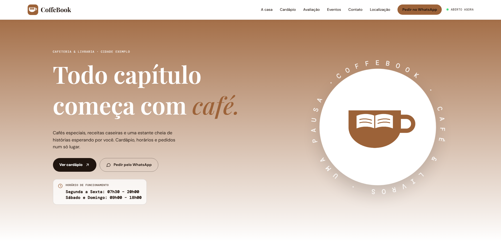

# ☕ CoffeeBook — Catálogo & Experiência de Café e Leitura

Uma aplicação web moderna desenvolvida para amantes de café e leitura, permitindo explorar harmonizações entre cafés especiais e livros, descobrir novos títulos e gerenciar recomendações personalizadas.

---

## 📸 Demonstração do Projeto

  

---

## 🚀 Tecnologias Utilizadas

Este projeto foi construído utilizando tecnologias modernas do ecossistema front-end:

- **Framework/Biblioteca:** React, Vite, JavaScript / TypeScript
- **Estilização:** Tailwind CSS / CSS Modules (com paleta temática inspirada em tons de café e papel antigo)
- **Gerenciamento de Estado:** Zustand / Context API
- **Hospedagem & Deploy:** Vercel

---

## ⚙️ Principais Funcionalidades

- **Catálogo Integrado:** Sugestões de leituras combinadas com perfis e notas de degustação de cafés especiais.
- **Busca e Filtros Dinâmicos:** Pesquisa ágil por gênero literário, intensidade do café, autor ou métodos de preparo.
- **Modo Escuro / Claro:** Leitura agradável e adaptável a qualquer ambiente.
- **Interface Responsiva & Fluida:** Design otimizado para navegação fluida em desktops, tablets e smartphones.
